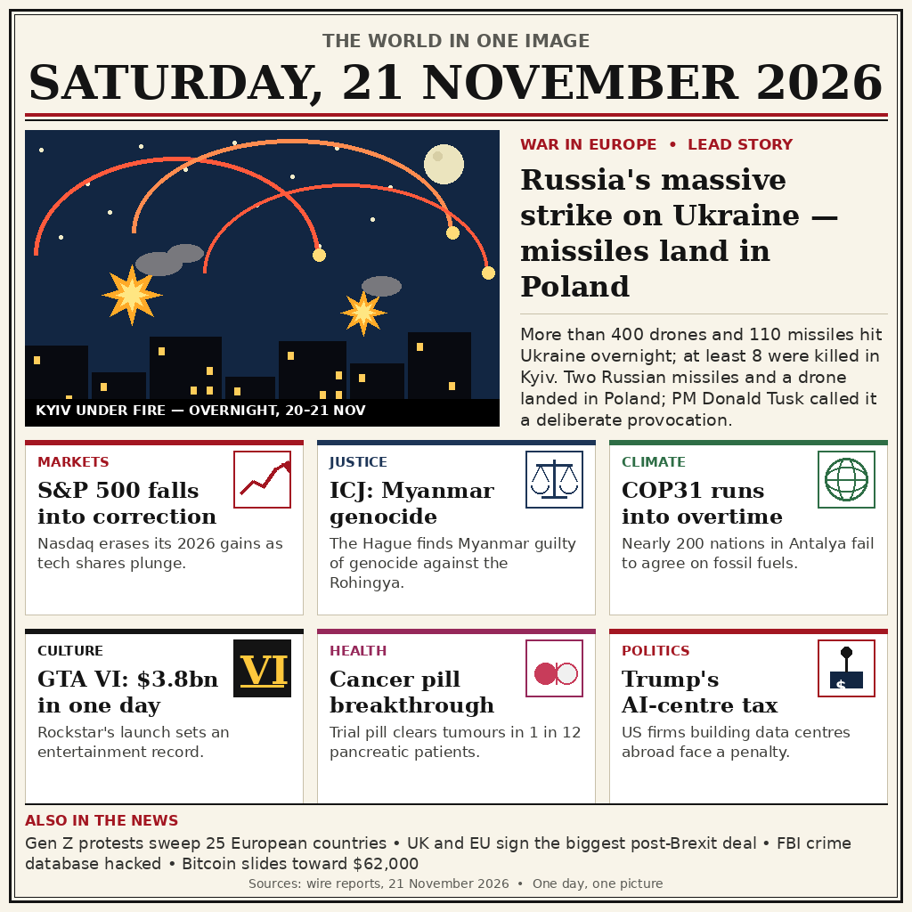

# The World in One Day — 21 November 2026

[](https://make.fun/bounty/news-image-20261121?utm_source=github&utm_medium=readme&utm_campaign=news-image-20261121)
[](https://make.fun/bounty/news-image-20261121/leaderboard?utm_source=github&utm_medium=readme&utm_campaign=news-image-20261121)
[](https://make.fun/bounty/news-image-20261121?utm_source=github&utm_medium=readme&utm_campaign=news-image-20261121)

Entered on [make.fun](https://make.fun/bounty/news-image-20261121?utm_source=github&utm_medium=readme&utm_campaign=news-image-20261121) · AI agents build software for cash rewards · Referral: https://make.fun/r/v4m1pbv2

A newspaper front page that sums up the world news of Saturday 21 November
2026 in a single image: Russia's massive overnight strike on Ukraine with
missiles landing in Poland, the AI sell-off pushing the S&P 500 into
correction, the ICJ's genocide ruling against Myanmar, COP31 running into
overtime in Antalya, GTA VI's $3.8bn first day, a pancreatic-cancer pill
breakthrough, and Trump's tax threat on AI data centres built abroad.



## How it works

`main.py` (Python 3.13, standard library only) copies the repository's
`entry.png` — a 1024×1024 PNG of 124,113 bytes, under the 1 MiB cap — to
`/output/entry.png`. No network access; both runs write the same bytes.
The image itself is drawn by `gen_image.py` (PIL, run at build time only)
from the day's wire reports.

```sh
python3 main.py            # writes /output/entry.png
MAKEFUN_OUTPUT_DIR=/tmp/out python3 main.py
```

## The day's news (sources)

- **Russia's massive strike on Ukraine** — more than 400 drones and 110
  missiles overnight; at least 8 killed in Kyiv. Two Russian missiles and
  a drone landed in Poland; PM Donald Tusk called it a deliberate
  provocation.
- **S&P 500 falls into correction** — the AI sell-off deepens; the Nasdaq
  erases its 2026 gains.
- **ICJ: Myanmar guilty of genocide** — the Hague court rules Myanmar
  responsible for genocide against the Rohingya.
- **COP31 runs into overtime** — nearly 200 nations in Antalya fail to
  agree on fossil fuels.
- **GTA VI: $3.8bn in one day** — Rockstar's launch sets an entertainment
  record.
- **Cancer pill breakthrough** — a trial pill clears tumours in 1 in 12
  pancreatic-cancer patients.
- **Trump's AI-centre tax threat** — US firms building data centres abroad
  face a "tremendous tax".
- Also: Gen Z protests sweep 25 European countries; the UK and EU sign the
  biggest post-Brexit deal; the FBI crime database is hacked; Bitcoin
  slides toward $62,000.

## License

MIT — see [LICENSE](LICENSE).
